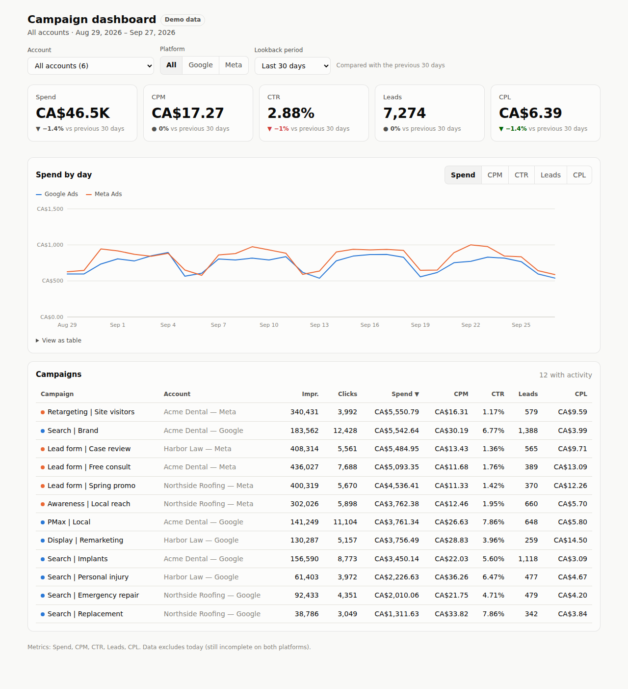

# Ad Campaign Dashboard

Google Ads and Meta Ads performance in one place, pulled through
[Composio](https://composio.dev).

- **Metrics:** Spend, CPM, CTR, Leads, CPL, each compared with the previous period
- **Account dropdown:** all accounts, or any single Google Ads / Meta Ads account
- **Platform filter:** All, Google or Meta
- **Lookback:** last 7 / 14 / 30 / 90 days, or a custom date range
- Daily trend chart (switchable metric, hover for values, table view) and a sortable campaign table
- Filters are kept in the URL, so any view can be bookmarked or shared
- Light and dark mode, works on mobile



Stack: Next.js 15 (App Router) + TypeScript. Data is fetched server-side, so API
keys and OAuth tokens never reach the browser.

## Run it locally

```bash
npm install
cp .env.example .env.local   # leave DATA_SOURCE=mock to start with demo data
npm run dev                  # http://localhost:3000
```

## Connect live data (Composio)

1. **Connect your ad accounts in Composio.** In the Composio dashboard, add the
   Google Ads and Facebook/Meta Ads toolkits and connect each login under one
   user id (e.g. `default`). A single Google login that can see several Google
   Ads accounts (directly or via a manager/MCC account) is enough, and the
   same goes for Meta.
2. **Get a Google Ads developer token.** In Google Ads, go to *Tools → API
   Center* on your manager account. The Google Ads API needs this token on every
   request. A new token only has test access until Google approves *Basic
   access*.
3. **Fill in `.env.local`:**

   | Variable | Value |
   |---|---|
   | `DATA_SOURCE` | `composio` |
   | `COMPOSIO_API_KEY` | from Composio → Settings |
   | `COMPOSIO_USER_ID` | the user id you connected the accounts under |
   | `COMPOSIO_GOOGLE_ADS_TOOLKIT` / `COMPOSIO_META_ADS_TOOLKIT` | toolkit slugs exactly as shown in Composio |
   | `GOOGLE_ADS_DEVELOPER_TOKEN` | from step 2 |
   | `GOOGLE_ADS_LOGIN_CUSTOMER_ID` | your MCC id (digits only), if you use one |

4. Restart `npm run dev`. The badge next to the title that says **Demo data**
   goes away once live data is on, and the account dropdown lists every
   account Composio can reach.

### How each metric is sourced

| Metric | Google Ads | Meta Ads |
|---|---|---|
| Spend | `metrics.cost_micros` ÷ 1,000,000 | `spend` |
| Impressions / Clicks | `metrics.impressions` / `metrics.clicks` | `impressions` / `clicks` (all clicks) |
| Leads | `metrics.conversions`, i.e. the conversion actions marked **Primary** in Google Ads (make sure your lead goals are the primary ones) | the first of `META_LEAD_ACTION_TYPES` found on each row (default: `lead`) |
| CPM | Spend ÷ Impressions × 1000 | same |
| CTR | Clicks ÷ Impressions | same |
| CPL | Spend ÷ Leads | same |

Derived metrics are always calculated from summed totals, so a 30-day CPL is
total spend ÷ total leads, not an average of daily CPLs.

Results are cached in memory for 15 minutes per account and date range.

## Changing the metrics

Everything the dashboard shows comes from `src/config/metrics.ts`. To add a
metric, add an entry with a label, a format (currency / number / percent),
whether higher is better (this sets the colour of the change vs the previous
period), and a formula over `spend`, `impressions`, `clicks` and `leads`. The KPI
tiles, chart toggle and table columns all update from that one list.

## Deploy (placeholder domain)

The simplest route is [Vercel](https://vercel.com): import the repo, set the
environment variables above, and deploy. You get a
`your-project.vercel.app` URL straight away, and you can attach a custom domain
later.

## Project layout

```
src/
  config/metrics.ts          ← the KPI definitions and lookback presets
  lib/sources/composio.ts    ← live Google Ads + Meta Ads fetchers (via Composio proxy)
  lib/sources/mock.ts        ← demo data
  lib/data.ts                ← picks the source, caches results
  lib/report.ts              ← aggregates daily campaign rows into a report
  app/api/accounts           ← GET list of ad accounts
  app/api/report             ← GET ?account=&platform=&from=&to=
  components/                ← Dashboard, KPI tiles, trend chart, campaign table
```

## Roadmap: client portal

The code is already set up for this. Composio groups connections by **user id**,
and the only place that id is read is `COMPOSIO_USER_ID` in
`lib/sources/composio.ts`. To turn this into a multi-client portal:

1. Add authentication (e.g. Supabase Auth, Clerk or Auth.js) so each client
   logs in with their own credentials.
2. Keep a `clients` table that maps each login to its Composio user id (and,
   optionally, an allowlist of ad account ids).
3. Pass the logged-in client's Composio user id into the data source instead
   of the env var, and include it in the cache key.
4. Add an onboarding page that uses Composio's connect link so clients can
   authorize their own Google Ads / Meta accounts.
5. Keep an admin view (this dashboard as it is today) where you can see all
   clients.

Before onboarding other businesses' Meta ad accounts, check whether your Meta
app needs **App Review for `ads_read`**. It isn't needed for accounts you manage
yourself.
